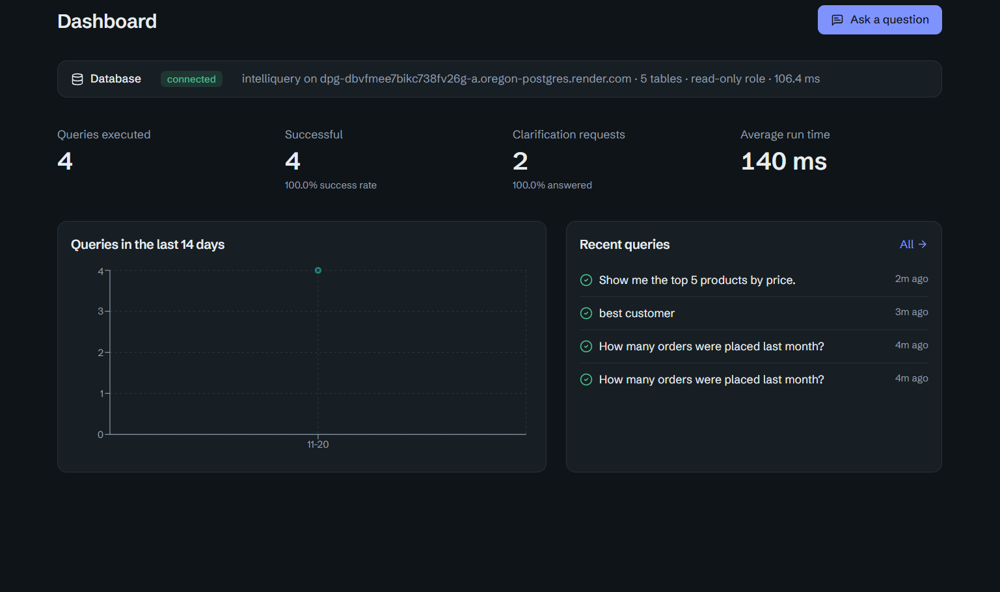
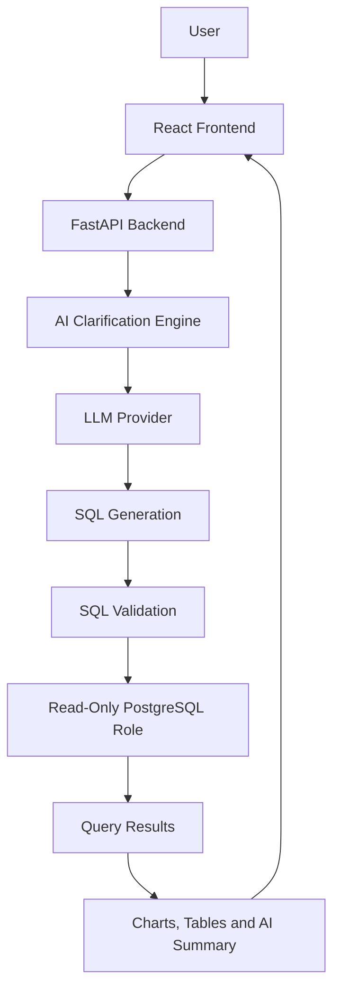

# IntelliQuery — AI-Powered Text-to-SQL

<p align="center">
  <strong>Ask your PostgreSQL database questions in plain English.</strong>
  <br />
  Turn natural-language questions into validated SQL queries, interactive results, and meaningful insights.
  <br /><br />
  <a href="https://intelliquery-frontend.onrender.com">Live Demo</a> ·
  <a href="https://github.com/mahesh-73m/IntelliQuery">GitHub Repository</a> ·
  <a href="https://intelliquery-backend.onrender.com/docs">API Documentation</a>
</p>

---

## Overview

**IntelliQuery** is an AI-powered Text-to-SQL application that allows users to interact with a PostgreSQL database using natural language.

Instead of writing SQL manually, users can ask questions such as:

- Show me the top 5 products by price.
- How many orders were placed last month?
- Who are our best customers?

When a question is ambiguous, IntelliQuery uses an intelligent clarification engine to ask follow-up questions before generating SQL.

The generated SQL is validated and executed using a restricted, read-only database role. Results are presented through tables, charts, and natural-language summaries.

## Application Preview



*IntelliQuery dashboard — database connection status, query analytics, and recent queries.*

## Key Features

- **Natural Language to SQL:** Convert plain-English questions into PostgreSQL queries using an LLM.
- **Intelligent Clarification:** Detect ambiguous questions and ask relevant follow-up questions.
- **SQL Validation:** Validate generated SQL before execution using SQLGlot.
- **Read-Only Database Execution:** Execute queries through a restricted PostgreSQL role.
- **Interactive Results:** Display query results in tables and charts.
- **AI-Powered Summaries:** Explain query results in plain English.
- **User Authentication:** Secure registration and login using JWT authentication.
- **Query History:** Access previous conversations and executed queries.
- **Saved Queries:** Save useful queries for future use.
- **Analytics Dashboard:** Monitor query execution, success rates, clarification requests, and execution time.

## Technology Stack

| Layer | Technologies |
|---|---|
| Frontend | React 18, Vite 6, Tailwind CSS |
| UI & Charts | Lucide React, Recharts |
| API Communication | Axios |
| Backend | Python 3.12, FastAPI |
| Validation | Pydantic, SQLGlot |
| ORM | SQLAlchemy |
| Database | PostgreSQL |
| Authentication | JWT, bcrypt |
| AI Integration | Google Gemini, Groq, OpenAI |
| Deployment | Render |

## Architecture



## How It Works

1. **User Input:** The user enters a question in natural language.
2. **Intent Understanding:** The AI pipeline interprets the question and identifies the requested information.
3. **Ambiguity Detection:** The clarification engine detects vague or ambiguous terms.
4. **Clarification:** If necessary, the application asks a follow-up question and remembers the user's answer.
5. **SQL Generation:** The LLM generates a PostgreSQL query.
6. **SQL Validation:** SQLGlot validates the generated query against the application's security rules.
7. **Query Execution:** The validated query runs using the restricted read-only database role.
8. **Result Presentation:** Results are displayed with tables, charts, and natural-language explanations.

## Security

IntelliQuery uses multiple security layers to reduce the risks associated with AI-generated SQL.

- Dedicated `iq_readonly` PostgreSQL role for analytical queries.
- Read-only transactions and database statement timeouts.
- SQL AST validation using SQLGlot.
- Only a single `SELECT` or `UNION` query is permitted.
- Restricted table and column access.
- Query result limits to prevent excessive data retrieval.
- JWT-based authentication and password hashing.
- User-level ownership checks for application data.
- CORS origin restrictions and environment-based secret management.

## Project Structure

```text
IntelliQuery/
│
├── backend/
│   ├── app/
│   │   ├── ai/
│   │   ├── api/
│   │   ├── core/
│   │   ├── database/
│   │   ├── evaluation/
│   │   ├── models/
│   │   ├── schemas/
│   │   ├── security/
│   │   └── services/
│   ├── tests/
│   └── requirements.txt
│
├── frontend/
│   ├── public/
│   ├── src/
│   │   ├── components/
│   │   ├── pages/
│   │   ├── services/
│   │   ├── hooks/
│   │   └── context/
│   └── package.json
│
├── database/
│   ├── 00_roles.sh
│   ├── schema.sql
│   └── seed.sql
│
├── docs/
├── scripts/
├── .env.example
└── README.md
```

## Local Development Setup

### Prerequisites

- Python 3.12
- Node.js and npm
- PostgreSQL 14 or later
- An API key from at least one supported LLM provider

### 1. Clone the repository

```bash
git clone https://github.com/mahesh-73m/IntelliQuery.git
cd IntelliQuery
```

### 2. Configure environment variables

Copy the example environment file:

```bash
cp .env.example .env
```

On Windows PowerShell:

```powershell
Copy-Item .env.example .env
```

Configure the database credentials, connection URLs, secret key, and your preferred LLM API key in `.env`.

### 3. Initialize PostgreSQL

Create the `intelliquery` database, configure the application and read-only database roles, and execute:

```bash
psql -d intelliquery -f database/schema.sql
psql -d intelliquery -f database/seed.sql
```

Configure the database connection URLs in `.env` using the appropriate PostgreSQL credentials.

### 4. Start the backend

```bash
cd backend
python -m venv .venv
```

Activate the virtual environment:

Windows PowerShell:

```powershell
.venv\Scripts\Activate.ps1
```

Install dependencies and start FastAPI:

```bash
pip install -r requirements.txt
uvicorn app.main:app --reload
```

Backend: `http://localhost:8000`

API documentation: `http://localhost:8000/docs`

### 5. Start the frontend

Open another terminal:

```bash
cd frontend
npm install
npm run dev
```

Frontend: `http://localhost:5173`

The Vite development server proxies `/api` requests to the local backend.

## Environment Variables

Important configuration variables:

| Variable | Description |
|---|---|
| `APP_ENV` | Application environment |
| `SECRET_KEY` | JWT signing secret |
| `APP_DATABASE_URL` | Application database connection |
| `READONLY_DATABASE_URL` | Restricted read-only database connection |
| `CORS_ORIGINS` | Allowed frontend origins |
| `LLM_PROVIDER` | Selected AI provider |
| `GEMINI_API_KEY` | Google Gemini API key |
| `GEMINI_MODEL` | Gemini model name |
| `GROQ_API_KEY` | Groq API key |
| `OPENAI_API_KEY` | OpenAI API key |
| `QUERY_TIMEOUT_SECONDS` | SQL execution timeout |
| `MAX_RESULT_ROWS` | Maximum query result rows |

Refer to `.env.example` for the complete configuration.

**Never commit real API keys, passwords, database URLs, or other secrets to GitHub.**

## Deployment

IntelliQuery is deployed on Render using separate frontend, backend, and PostgreSQL services.

| Component | Deployment |
|---|---|
| Frontend | Render Static Site |
| Backend | Render Web Service |
| Database | Render PostgreSQL |

**Live links**

- Application: https://intelliquery-frontend.onrender.com
- Backend API: https://intelliquery-backend.onrender.com
- API documentation: https://intelliquery-backend.onrender.com/docs

The frontend uses `VITE_API_URL` to connect to the backend. The backend uses `CORS_ORIGINS` to allow requests from the deployed frontend.

**Free-tier note:** Render free web services may spin down after inactivity, and free PostgreSQL databases have limited lifetimes. These limitations can affect availability and long-term data persistence.

## Testing

Run backend unit tests:

```bash
cd backend
pytest tests/unit
```

Run the evaluation dataset:

```bash
python tests/eval/build_dataset.py
python -m app.evaluation.runner --runs 1
```

Evaluation covers query execution accuracy, clarification behavior, successful query rate, and execution performance.

## Future Improvements

- Optimize frontend bundle size and loading performance.
- Improve query-generation accuracy and evaluation coverage.
- Add more visualization options.
- Improve handling of database and LLM provider failures.
- Introduce persistent production database hosting.
- Add automated deployment and testing workflows.

## Author

**Mahesh Mahapatra**

- GitHub: [mahesh-73m](https://github.com/mahesh-73m)
- Project: [IntelliQuery](https://github.com/mahesh-73m/IntelliQuery)
- Live Application: [Try IntelliQuery](https://intelliquery-frontend.onrender.com)

---

If you find this project useful, consider giving the repository a ⭐ on GitHub.
